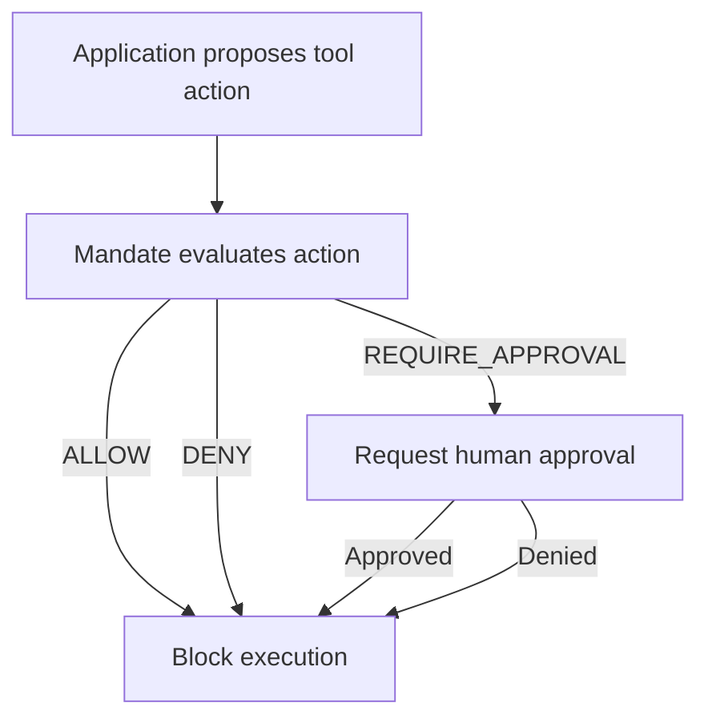

# Mandate

[[!tag security python library authorization ai-agent]]

## Project name and tagline

**Mandate**: Policy enforcement for AI agents.

Core idea: give AI agents the authority they need, not unrestricted power. Mandate evaluates whether an action should proceed before the protected tool executes.

## The problem

AI agents often need to call tools — reading files, exporting data, making web requests. But the fact that an agent *can* select a tool and propose an action doesn't mean every action should be authorized. Authorization should be separate from an agent's reasoning and tool implementation. Without a dedicated authorization layer, agents may:

- Read files outside the intended workspace
- Export sensitive data without oversight
- Make web requests to untrusted destinations
- Execute actions with unintended side effects

Mandate provides the authorization boundary that agent frameworks need but cannot provide on their own.

## What is Mandate?

**Mandate** is a standalone, framework-agnostic Python library for authorization and policy enforcement around AI-agent tool calls.

- **Mandate is an independent project**, not a FRIDAY-only component. FRIDAY will be its first integration and proving ground.
- **Authorization decisions** (`ALLOW`, `DENY`, `REQUIRE_APPROVAL`) are enforced before protected tool execution.
- **Structured authorization audit events** are emitted for every decision.
- **Single-use, atomically consumed approvals** prevent reuse and double-consumption.
- **Default-deny** behavior for actions that are actually covered by Mandate.

Mandate is an open-source project. It is intended to be usable by other developers without adopting FRIDAY or a particular agent framework.

## How it works

An application proposes a tool action. Mandate evaluates the action against configured policies. The application enforces the resulting decision before execution.

**Mandate cannot protect calls that bypass the authorization boundary.** Any tool called without going through Mandate's enforcement path is unprotected.

### The three outcomes

- **ALLOW**: The tool call is authorized to proceed. Execution may continue.
- **DENY**: The tool call is prohibited. Execution must not proceed.
- **REQUIRE_APPROVAL**: The tool call is conditionally authorized pending human approval. Execution must not proceed until an approval is obtained and validated.

## Key design principles

- **Default-deny**: Actions not covered by any ALLOW rule are denied.
- **Explicit authorization policies**: Policies are defined by the application in JSON or YAML. YAML is the primary human-authored format.
- **Absolute DENY precedence**: An explicit DENY rule takes absolute precedence over ALLOW or REQUIRE_APPROVAL.
- **Single-use, atomically consumed approvals**: Each approval authorizes the exact approved action exactly once. Consumption is atomic so that concurrent attempts cannot both succeed. Once consumed, an approval cannot authorize another execution, even with identical tool_name, parameters, and context.
- **Audit events with sensitive-data sanitization**: Sensitive data, credentials, tokens, and argument values are redacted from audit events.
- **Separation between authorization decisions and application-level enforcement**: Mandate makes the authorization decision; the application enforces it in the real tool-dispatch path.

## MVP scope

Mandate's first release is intentionally limited to demonstrate the core security value:

- **Filesystem operations**: `file_read`, `file_write`, `file_delete`
- **Data export**: `data_export`, `scan_directory`
- **Web requests**: `http_get`, `http_post`

- **Policy authoring format**: JSON and YAML. YAML is the primary human-authored format. JSON provides equivalent policy capabilities.
- **Tool-name matching**: Exact string match or the universal wildcard `*`. A condition `{"tool_name": "*"}` matches any tool name; an exact string `{"tool_name": "file_read"}` matches only the tool named `file_read`. Prefix or glob matching such as `file_*` is not supported in MVP unless explicitly approved in a future version.
- **No arbitrary Python predicates or policy-defined code execution**: The library never uses `eval` or executes arbitrary policy expressions.
- **No shipped base policies**: Guard starts empty; users must supply their own policies explicitly.

## Policy decision semantics

- **Explicit DENY always wins**: An explicit DENY rule takes absolute precedence across all loaded policies.
- **Otherwise, REQUIRE_APPROVAL wins over ALLOW**: If no DENY matches, REQUIRE_APPROVAL takes precedence over ALLOW.
- **First matching rule wins within a policy file**: Rules are evaluated top-to-bottom within a single file. The first rule whose condition matches (tool_name + all parameters) determines that file's contribution.
- **Policy file precedence**: Earlier files have lower precedence (their rules are checked first), and later files can override. But file ordering cannot override the global decision hierarchy: DENY > REQUIRE_APPROVAL > ALLOW.
- **No matching rule means DENY**: If no rule matches in any loaded policy, the decision is DENY (default-deny).
- **Evaluation failure raises `PolicyEvaluationError` and must prevent execution**: Unexpected policy-evaluation failures raise `PolicyEvaluationError`; the caller must block execution; no ALLOW decision is produced.
- **Invalid policy configuration raises `PolicyValidationError`**: Invalid policy definition on load raises `PolicyValidationError`; the policy is not loaded.

## Approval lifecycle

- **Approval requests are bound to the exact action and relevant context**: Each approval is bound to the exact tool name, parameters, and relevant security context at the time of request.
- **Each approval is single-use**: A consumed approval cannot authorize another execution, even for identical parameters.
- **Consumption is atomic**: Concurrent attempts to consume the same approval cannot both succeed.
- **Reuse, expiration, invalidation, or failed authorization cannot permit execution**: Expired, denied, invalidated, or already-consumed approvals must never authorize execution.
- **Retry after execution failure requires fresh authorization**: A retry following execution failure requires new authorization. Where applicable (REQUIRE_APPROVAL), a new approval must be requested; the previously consumed approval cannot be reused.

## Security boundaries and limitations

- **Mandate is an authorization layer, not a complete sandbox**: Integrating applications must enforce decisions in the real tool-dispatch path.
- **Tool implementations still require their own controls**: Tool implementations still require their own controls against issues such as filesystem vulnerabilities, path traversal, and SSRF.
- **Do not promise protection against arbitrary code that bypasses Mandate**: Mandate is an authorization layer, not a complete sandbox. Tool implementations still require their own controls.

## Project status

This repository contains the **design documentation and final sign-off for Mandate Phase 1**. The design is complete and approved. No implementation code has been shipped; this repository documents the design intent, API contract, and security guarantees for the Mandate MVP.

- **Design decisions are explicitly approved** and documented across the 9 companion design documents.
- **The single-use approval consumption contract** is defined and documented but has not been implemented in code.
- **No package is installable** from this repository; it design-only until implementation planning begins.

## Roadmap

- Keep it high-level and limited to the approved MVP.
- No release dates are invented or unapproved features promised.

## Contributing and license

The license has not yet been specified for this project. Contributions are welcome via the project's issue tracker, where design questions and documentation corrections can be discussed.

[[!tag discuss design security ai-agent]]

---

*This README accurately represents the current state of Mandate as a design-only project. It does not claim the package is installable, production-ready, or test-verified because no implementation code exists in this repository.*
